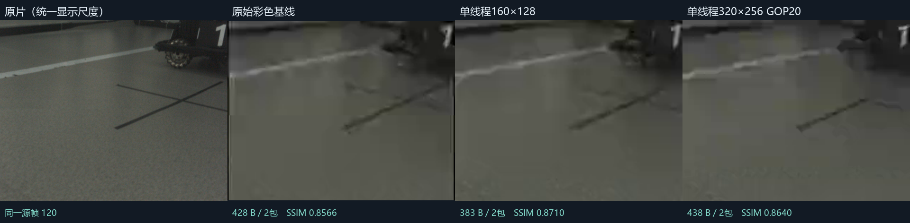
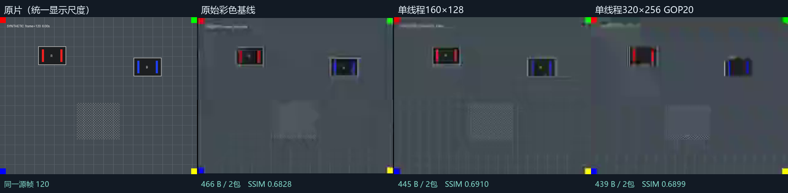

> **后续进展（2026-11-12）：** B档已完成Jetson部署，配合云台DMA修复接回官方图传，CH确认实车成功。现役步骤统一见[实车成功版本](../../../docs/2026-11-12-实车成功版本.md)。下文保留11月9日当时的仿真验收和未完成状态。

# 策略探索验收：2026-11-09至11-10

本轮实现策略配置、真实运行路径的前/后处理、独立收包重放和统一对比播放器；探索39份配置，合并重复效果后主播放器展示9档。**原始彩色192×152/20fps/GOP10基线没有替换。** 推荐先对照看`one-160`与`one-320-gop20`，再决定试车档；不是按一个分数自动选冠军。

## 直接看结果

在`compression-war`运行`scripts/启动-策略对比.bat`打开本机统一入口。相机原片和合成运动分开；主播放器的数据来自解锁后、不干预窗口的新跑全片记录，有实际提交时间线与同源帧模式。也有`runs/strategies/交付-运动对比-统一尺度.mp4`预览（重新编码的视频不是像素证据，逐帧PNG和收包摘要才是）。队员新电脑按[使用说明](../策略试验使用说明.md)重新生成。





两图均来自源帧120。四栏相同显示框、同一双三次缩放；右栏来自独立包重放，不是另跑高码率编码。左栏仅是参照。相机原片只有15秒、300帧；60秒通过循环它完成，不等于采集了60秒新场景。合成运动12秒、240帧，包含静止、移动、细纹理、红蓝标记、暗场和突变。

## 收益与代价

统一参照为**未经候选处理的原片**，显示尺度最长640×512，去掉候选的已知补边后对齐完整有效视野。SSIM是非重叠8×8亮度块统计，不与历史旧离线SSIM数值混比。质量计算全部在实时测量之后；表格包括启动首帧，没有挑掉画质差的首帧。

| 档位 | 编码尺寸 / GOP | 相机原片SSIM-Y | 合成运动SSIM-Y | 合成颜色误差↓ |
|---|---|---:|---:|---:|
| 原始彩色基线 | 192×152 / 10 | 0.8638 | 0.6665 | 1.816 |
| 单线程160×128 | 160×128 / 10 | 0.8764 | 0.6667 | 1.650 |
| 单线程320×256 | 320×256 / 10 | 0.8736 | 0.7070 | 1.892 |
| 单线程320×256关闭AQ | 320×256 / 10 | 0.8781 | 0.7022 | 2.129 |
| 单线程320×256 GOP20 | 320×256 / 20 | 0.8824 | 0.7276 | 1.763 |
| 灰度；不恢复颜色 | 192×152 / 10 | 0.8635 | 0.6694 | 5.448 |
| 保留亮度；4像素颜色块 | 192×152 / 10 | 0.8633 | 0.6667 | 1.982 |
| 高门限因果时域降噪 | 192×152 / 10 | 0.8633 | 0.6659 | 1.799 |
| 接收端限幅锐化 | 192×152 / 10 | 0.8579 | 0.6628 | 1.826 |

- **160×128、单线程单分片**：相机素材评分提高，运动画质接近基线；牺牲细线/小字空间分辨率。适合先看主体轮廓和稳定连续性，不能把更高SSIM理解成更多采集细节。
- **320×256、GOP20**：细节保留最有价值，真实颜色仍在H.264里；牺牲丢包后的恢复速度。适合链路稳定时；先与基线并排看转向、远处小物体。
- **320×256、GOP10**：保留较多空间细节，恢复比GOP20快；关闭AQ在相机片段更好，在合成运动反而不如保留AQ。保留为取舍档，不将静态素材优胜推广为所有场景最优。
- **灰度**：本轮亮度收益很小，颜色误差明显增加；没有伪装成颜色还原。粗颜色、时域降噪本轮收益也不突出。
- **锐化/放大**：独立接收后处理已接入且实际计时，但本轮客观保真降低；视觉上可能更硬锐，不算新增真实细节。未把它们移植到正常客户端。
- `slice1/slice2`早期声明值在auto线程下实际仍是2个VCL NAL；单线程候选才实际为1。重复效果合并展示，完整探索表在精选证据`exploration.csv`，原配置保留可复现。
- 本轮没有生成式上色、重模型或插帧的实测成绩，不把设想写成结果。所有档完整视野、真实传输颜色/灰度，动态旁路辅助信息为0。

以下为新跑合成运动全片的阶段实际耗时，单位ms；编码包含管道交付与输出获取，后处理包含本次像素转换/声明算法。只代表这台Windows，不推断Jetson速度。

| 档位 | 前处理P50 | 编码P50 | 接收后处理P50 | 编码P95 |
|---|---:|---:|---:|---:|
| 原始彩色基线 | 1.361 | 1.701 | 0.267 | 2.597 |
| 单线程160×128 | 1.112 | 1.840 | 0.201 | 2.620 |
| 单线程320×256 | 1.361 | 3.111 | 0.641 | 4.575 |
| 单线程320×256关闭AQ | 1.358 | 2.717 | 0.639 | 3.725 |
| 单线程320×256 GOP20 | 1.376 | 3.125 | 0.622 | 4.222 |
| 灰度；不恢复颜色 | 1.453 | 1.722 | 0.285 | 3.130 |
| 保留亮度；4像素颜色块 | 1.655 | 1.558 | 0.273 | 2.474 |
| 高门限因果时域降噪 | 1.380 | 1.613 | 0.280 | 2.386 |
| 接收端限幅锐化 | 1.373 | 1.736 | 1.719 | 2.967 |

## 解锁后60秒验收

用户先前锁过屏；00:19工具观察到锁屏，用户随后明确解锁。已实测原生窗口开始、停止、重播、1:1及中文路径策略选择，切换后清空旧画面。**早先25轮只保留为未知桌面状态记录，不用它们证明实际可见刷新，也不把12/13fps两次异常直接归因于算法。** 下表使用解锁后的相机记录与不干预窗口的重复运动记录。另有一组解锁后显示异常，完整保留在下一节；不能把它删掉只报通过轮次。

| 档位 | 60秒轮数 | 每轮稳态最低新图fps | 延迟P50范围ms | P95范围ms | 结果 |
|---|---:|---|---:|---:|---|
| 原始彩色基线 | 4 | 19 / 19 / 20 / 19 | 92.1–97.9 | 104.9–117.9 | PASS |
| 单线程160×128 | 4 | 19 / 19 / 20 / 17 | 89.6–101.4 | 110.5–118.4 | PASS |
| 单线程320×256 | 4 | 19 / 19 / 20 / 20 | 96.3–105.6 | 108.4–121.9 | PASS |
| 单线程320×256关闭AQ | 4 | 19 / 19 / 19 / 20 | 93.8–105.8 | 112.9–121.4 | PASS |
| 单线程320×256 GOP20 | 4 | 19 / 19 / 19 / 19 | 92.0–105.2 | 112.3–121.7 | PASS |

上述明确测试条件下共20轮，20轮通过。各档相机2轮、运动2轮；去掉首2秒和尾部不完整秒，每个稳态完整秒要求至少15张新源帧。计时为原片入链→实际GDI提交完成，不是相机曝光→显示器光子延迟。重绘同一帧不计新帧。未修改编码参数或显示统计来消除失败。

这些记录中最大实发单帧524 B，最短逐包间隔20.0842ms，滚动一秒最多42包。所有独立包重放和后处理输出比对通过。每帧含关键帧≤592 B/2包；每个数据段300 B、外层309 B。H.264、内层头、补零、外层开销分别记账，不拿PNG大小当传输字节数。

本机进程内存采样及有界队列上限见`memory-samples.json`和各份`unlocked-*-acceptance.json`；只采集cw_live工作集，不把它冒充整个Jetson或外部FFmpeg总内存测试。没有观察到这些60秒记录中的队列无限增长。

### 显示异常保留与测试干预

解锁后的第一组运动测试出现过解码约20fps、GDI提交只有0–9fps的异常，以下是原始失败结果：

| 档位 | 结果 | 稳态最低fps | 不足15fps整秒数 | 解码 / 提交图像数 |
|---|---|---:|---:|---|
| baseline | PASS | 19 | 0 | 1199 / 1199 |
| one-160 | FAIL | 0 | 6 | 1199 / 1073 |
| one-320 | FAIL | 0 | 57 | 1194 / 228 |
| one-320-aq0 | FAIL | 0 | 58 | 1195 / 267 |
| one-320-gop20 | FAIL | 0 | 57 | 1190 / 256 |

随后一次单独60秒对照中，前34秒约20fps，在桌面自动化`Raise`调用持续的约9秒内降到1–13fps，调用结束后恢复20fps。该时间重合支持“窗口交互/测试环境影响”的可能性，**不足以证明所有先前异常的唯一根因**。为隔离这一因素，`unlocked-no-ui-automation`期间不调用桌面自动化、不点击、不改变尺寸，程序、输入和策略均保持相同。该组的成功仅证明这一运行条件；仍保留显示异常作为限制，不能承诺被遮挡、锁屏或外部工具干预时保持刷新。

完整日志和每秒计数在`display-investigation/`；这里没有把解码fps冒充显示fps。原片按正常速度输入，显示错过的帧不会事后补算。

## 故障与独立性证据

固定丢掉**源帧25的第一包**，其他条件不变：GOP10在源帧31恢复，丢包→新画面约361.8ms、两次显示间隔384.3ms；GOP20在源帧41恢复，约860.8ms、显示间隔898.4ms。这是本次Windows理想链路故障注入，不是实车无线丢包分布预测。

关键原始输出：

```text
PASS live protocol: 131747 checks (car CRC golden, corruption, protobuf, packet limits, sequence wraps, full FOV fit)
PASS two-packet realtime and independent wire proof: runs\two-packet-validation\20261109_232925_813
PASS strategy faults, postprocessing replay, tamper rejection, reset and preserved baseline
PASS vehicle trial: 1022 checks; exact serial methods; every video/control short-write offset; pacing; retry; SEI; legacy matrix
source_video_read=0
observation_ids_used=0
client_decoder=unmodified
pixel_sha256_match=1
processed_sha256_match=1
```

全丢包测试覆盖320两档、GOP20、灰度和接收放大：源视频继续、右侧0图。关键帧超限整帧拒绝并恢复；前处理/编码100ms负载造成待处理覆盖，后处理100ms负载使延迟中位到2743ms而输入仍100帧/5秒。不是放慢原片来伪造实时。五个代表档分别完成横屏、竖屏四角及变帧间隔共15项独立收包/像素复核，四角位置按等比补边后的坐标核对；这组是无窗口功能回归，不算显示fps验收。

只复制5个接收证据文件到空目录，仍可独立重建后处理输出。故意改掉重建参数的原始拒绝输出：

```text
FAIL independent replay: receiver reconstruction pixels do not match runtime
```

加入`input=car_raw.bgr`也被接收配置拒绝。因果时域策略两次重新启动首帧像素一致。原双包里程碑包记录在复制目录复核，历史原文件没有覆盖；旧离线逐帧SHA256仍为：

```text
c6b2be6d8306acc3cf152c7e52df6dfaf3c4d4222eb1a39841295da794bd9428
```

第一版主机线程测试曾报`FAIL worker ownership/retry`：测试把8包完成硬设为220ms，Windows睡眠粒度下不成立。修正为等待8个实际确认、最多2秒，并保留每个实际间隔≥20ms断言；不是放宽包率。编译另有第三方FFmpeg头的C4244和提取旧串口方法的未用变量C4101警告，无编译错误。

手动单窗复查曾从外部工作目录启动，窗口显示`找不到ffmpeg.exe`；在`compression-war`目录按正式入口重跑后启动正常。该失败没有计入策略性能成绩。

## 边界、未完成项

1. C板旁路、理想通道；未测官方图传内部队列、VT03/VT13无线性能或Jetson实时负载。
2. Jetson可选试验源码和8文件ZIP已准备，串口主机回归通过；**ARM/CUDA依赖构建、相机实际取帧和上车测试尚未执行**。详情及回退见[车端交付](../../../docs/2026-11-12-实车成功版本.md)。正常客户端、C板均未修改。
3. 本地HTML的浏览器自动点击受工具file://策略限制，未绕过。纯JS测试覆盖真实到达时刻、冻结年龄、同帧缺失留空、选择及步进；原生cw_live窗口交互已检查。播放器的最终浏览器布局/点击仍需用户实看。
4. 现有相机片段较单一；红蓝统计只是饱和像素检查，不是敌我识别准确率。请用更多比赛运动素材复验，不用一个SSIM阈值宣称操作手一定舒服。

## 复现与上传

```powershell
# 在 compression-war 目录
python .\tools\run_strategies.py --out .\runs\strategies\new-camera --profiles baseline one-160 one-320 one-320-aq0 one-320-gop20 --duration 60 --repeat 2 --no-export --no-compare
python .\tools\verify_strategies.py --out .\runs\strategies\new-faults
powershell -NoProfile -ExecutionPolicy Bypass -File '.\scripts\验证-车端试验主机.ps1'
.\cw_wire_verify.exe --fast .\evidence\strategy-milestone\quality-camera
.\cw_wire_verify.exe --rx-only --fast .\evidence\strategy-milestone\postprocess-proof
```

提交源码、39份小配置、统一文档及精选证据；大原片、逐帧PNG、视频预览、exe、ZIP和大量会话留在忽略目录。Git操作由CH执行，未代为add/commit/push。不要把既有`luojiamaster/源码/cmake_build_log.txt`顺带提交：

```powershell
Set-Location -LiteralPath 'C:\Users\CH\Desktop\robot记录\luojiafox'
git add -- README.md compression-war autoaim/my_lf_INF_20261025/io/gimbal/gimbal.cpp autoaim/my_lf_INF_20261025/io/gimbal/gimbal.hpp autoaim/my_lf_INF_20261025/io/video_sender autoaim/my_lf_INF_20261025/src/standard_mpc.cpp autoaim/my_lf_INF_20261025/tests/video_sender_test.cpp
git diff --cached --stat
git commit -m "feat(compression-war): add verified strategy comparisons and opt-in Jetson trials"
git push origin HEAD
```
