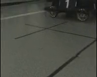
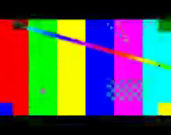
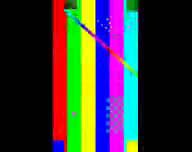

# 双包里程碑的最小复核证据

这里只保留2026-11-09已验收的一次60秒真实相机运行，约2.3 MB。原始来源为本机`runs/two-packet-validation/20261109_191606_298/gui60`；重复试跑、GB级原片、编译产物与完整原片PNG继续留在被忽略的目录。

在`compression-war`根目录编译后运行：

```powershell
.\cw_wire_verify.exe '.\evidence\two-packet-baseline'
# 约60秒后，退出码0且pixel_sha256_match=1
```

仅接收端重放：

```powershell
.\cw_wire_verify.exe --rx-only '.\evidence\two-packet-baseline'
```

此入口只读取`rx-300.bin`、`rx-times.csv`、`decoded.csv`，三个文件复制到空目录后也能运行。预期摘要不参与解码。源码使用未修改的客户端解码器，运行仿真观测信息没有进入传输载荷。

| 文件 | 作用 |
|---|---|
| `tx-0310.bin`、`tx-times.csv` | 实际发出的309 B外层帧、时间及接受/丢弃状态 |
| `rx-300.bin`、`rx-times.csv` | 真正进入接收队列的300 B数据及实际到包时间 |
| `decoded.csv` | 实时输出逐帧顺序、尺寸、RGBA像素SHA256 |
| `display-seconds.csv` | 实际窗口每个稳态完整秒的新画面提交次数 |
| `events.csv`、`per_frame.csv` | 在线交错事件与逐帧耗时，不参与独立重放解码 |
| `summary.txt`、`runtime-console.txt` | 实际配置、计数、延迟、队列与内存采样 |
| `wire-verification.txt`、`rx-replay-verification.txt` | 验收时的完整与接收端重放结果；重跑会刷新这两份结果 |
| `received-*.png` | 相机、横屏及竖屏的真实接收结果，只用于看图 |
| `SHA256SUMS.txt` | 本目录原始交付文件摘要，不包含此摘要文件本身 |

预期核心结果：2347包、1200帧像素一致；最大帧525 B、最大关键帧475 B；最短包间隔20.0789 ms、滚动1秒最多44包。正常显示57个完整秒最低19 fps。

查看原生接收图像：





二进制包和PNG按二进制入库，CSV/TXT保留原始字节，避免Git换行转换导致证据SHA256变化。重放生成的`replayed-decoded.csv`可随时重新得到，不重复入库。
