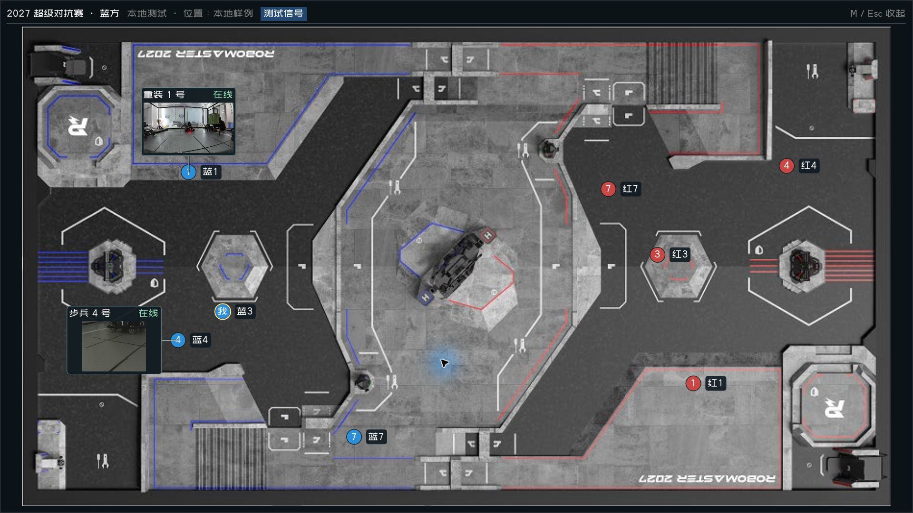

# luojiamaster 自定义客户端

**luojiafox 珞珈狐战队 · made by CH**

**先解压仓库，再双击 [程序/luojiamaster.exe](程序/luojiamaster.exe)。** 在一台 Windows 电脑上选「本地测试」就能试完整比赛界面。开场先按 **F11** 全屏。接已有车辆和 2026 官方端时选「2026 超级对抗赛 → 正式登录」。

新电脑需要的文件、可选场馆和参考车经验见 [部署教程](部署教程/README.md)。想看哪些功能已交付、哪些还要做，见 [2027 开发路线](部署教程/2027开发路线.md)。

## 打开客户端

| 首页选项 | 可以体验什么 | 验证到了哪里 |
| --- | --- | --- |
| 2026 超级对抗赛 | 原登录、地图、比赛菜单、官方视频与工业相机；操作手可按岗位看另外两位队友 | 参考车已跑通完整视频链路。新版操作、自动配对和多机互看还要用这个入口上车复测 |
| 2027 高校联盟赛 | 3V3 比赛画面、双方控制度和六根血条、两路本车视频、联盟赛地图、一位队友视角 | Windows 本地赛况和实录已验证，正式入口也用本机测试服务核过。2027 官方端联调待做 |
| 2027 超级对抗赛 | 重装、步兵首屏显示比赛阶段、比分、双方基地、R/B 前哨、累计控制度和八台车的血量。按 Esc 可看本岗位的底盘或装配菜单，以及回血、复活申请。指挥席可在地图上看局数、时钟和比分 | 操作手已用本地测试及正式入口连接本机模拟服务验证。指挥席目前从本地测试进入，2027 官方端待联调 |

操作手的正式与本地入口共用比赛界面。正式登录接收现场数据，没收到视频显示等待。本地测试跳过官方登录，用内置实车录包和样例赛况，可以在这台电脑上换队、开菜单、试断流。

### 在自己电脑上试一局

1. 选「2027 高校联盟赛 → 本地测试 → 红方 → 步兵 3 号 → 开始测试」，按 **F11**。主画面是官方视频，工业相机在副窗，右下是联盟赛小地图。按 **H** 换主视角，再按 **M** 看完整场馆。按 **M** 或 **Esc** 就回到刚才的视角，录像继续播放。红方和蓝方的大图都与自己的小图同向。这版只显示场地。[查看联盟赛全屏图](档案/配图/3V3全场地图.jpg)
2. 看顶栏。两方控制度均从 600 开始，下面每方是重装 1、步兵 3、哨兵 7 的血条。第 6 秒红步兵降到 150/300，第 9 秒左右时钟暂停，第 19 秒蓝步兵归零、蓝方控制度降到 585。模拟赛况约 39 秒一轮。缺数据会显示「等待」，收到零会显示 0。
3. 在比赛画面按 **I** 将官方视频转 180°，按 **Esc** 开关比赛菜单。三个赛事都默认按录像或图传的原方向显示。菜单里返回赛事选择，换蓝方重开，上一局的状态清空。

正式比赛的控制度按裁判消息更新。重装 1 号的满血从 100 变为 450，取决于模块安装进度；步兵 3 号按底盘为 300 或 350；哨兵 7 号为 400。中途登录、还不知道对方满血值时，血条只标收到的血量，每格代表 100 点。

### 超级对抗赛怎么看赛况和地图

选「2027 超级对抗赛 → 本地测试 → 红方重装 1 → 开始测试」，按 **F11**。先看视频上方。两队基地满血各 10000，R、B 两座前哨站各 1000。八台车按双方的重装 1、步兵 3、步兵 4、哨兵 7 排列。刚进场时显示「等待」，收到血量后再亮数字。

左下角显示本岗位状态。红方重装 1 在登录后约第 33 秒看到全场装配通报「超时」，第 44 秒看到「成功」，己方科技等级从 0 升到 1。装配通报没有队伍或车号，不能用它认定本车上一次申请成功。步兵 3、4 的底盘一栏显示本车实际同步的配置。

**7V7 本地互动测试每轮 64 秒，从点「开始测试」算起。** 第 0～21 秒准备，第 22～24 秒裁判自检，第 25～27 秒开赛倒计时，第 28 秒开赛。第 34～38 秒暂停，第 39 秒恢复，第 58 秒进入结算，第 64 秒开始新一轮。3V3 和原有 39 秒回归样例各用原来的时间。阵地变化、装配通报等短消息显示在倒计时下方，按 M 看地图或按 L 看队友也能看到。错过的消息可在系统日志里查。

1. 选「2027 超级对抗赛 → 本地测试 → 蓝方步兵 3 → 开始测试」，按 **F11**。小地图在右下，按 **M** 打开同方向的大图。蓝 1、蓝 4 各有一块随车视频，本车标「我」。地图上写着「位置：本地样例」，视频取自队里的实车录像。
2. 鼠标移上小窗，小窗停稳。单击就地放大，点另一位切换，再点缩回。在视频上滚轮缩放。**M** 或 **Esc** 回到之前的视角；先按 **L** 看队友再开图，关图会回到队友画面。
3. 在地图的测试信号里分别暂停位置或视频。位置断更 3 秒变淡、10 秒隐去，仍在播放的视频收在地图下方。单独断开录像时，对应的位置继续更新。

2027 操作手的大小图均将己方放在左侧；指挥席二维图固定红左蓝右。2026 使用旧场地和原小地图朝向，1 号岗位显示「英雄」。两个赛季的正式入口均可用 **M** 查看静态场馆。新增的车辆与随车视频目前仅用于本地回放。

### 按 Esc 试一遍 7V7 岗位菜单

1. **试步兵。** 选「2027 超级对抗赛 → 本地测试 → 红方步兵 3 → 开始测试」，按 **F11 → Esc**。准备阶段点「功率优先」，先显示「等待状态同步」，随后看到「回传值一致」。查看本车当前底盘，再等到开赛，按钮变灰。下一局不选，开赛后本地裁判样例给出默认的「血量优先」。
2. **试重装。** 换红方重装 1。按 **Esc**，到第 28 秒开赛后，选「一级」点「申请开始」，观察核心状态从初始位置变成运动中、已到位，再试「申请确认装配」或「申请取消」。菜单里的当前核心状态、上次申请和最近全场通报分开显示。
3. **试复活。** 换蓝方步兵 3。约第 32 秒样例血量降到 0，菜单出现待复活、580 金币的立即复活报价。暂停时按钮变灰，第 39 秒恢复。点本地的回血或复活只记录这次操作，画面继续按样例更新。正式端看裁判同步的血量和复活状态。

这一版已接底盘、装配、回血及复活。其他 2027 岗位菜单项目见[开发路线](部署教程/2027开发路线.md#二当前开发顺序)。

### 操作手看队友

三个赛事均按登录阵营和岗位自动配对。联盟赛重装 1 和步兵 3 互看；两个超级对抗赛中，1、3、4 号各看另外两席，2026 赛季的 1 号是英雄。正式互看使用专用队友有线网，各机具体地址和检查方法见 [工具与接线](工具/README.md#四台电脑的当前摆法)。

| 操作 | 联盟赛 | 两个超级对抗赛 |
| --- | --- | --- |
| M / Esc | 展开 / 收起联盟赛全场图 | 展开 / 收起当年场馆。两路随车小窗在本地测试可见 |
| K | 收起或展开右侧一格 | 收起或展开右侧上下两格 |
| L | 放大一位队友，再按回本车 | 打开两路左右并排，再按回本车 |
| 单击、滚轮 | 在队友画面上滚轮放大细节 | 在并排页单击某一路单独看，再点回两路。滚轮只放大鼠标指着的画面 |

### 不上车试一次 7V7 指挥席

1. 选「2027 超级对抗赛 → 本地测试 → 红方或蓝方 → 指挥手 → 开始测试」，按 **F11**。默认选中「随车小窗」，重装 1、步兵 3、步兵 4 的实车录像各自跟着己方同号棋子。录像分别来自官方图传、工业相机原片第 5～9 秒和第 10～14 秒。地图上的八辆车使用本地位置样例。
2. 鼠标移到小窗上，小窗停稳，录像继续。**单击放大，再点缩回；直接点另一路就换人。** 在视频上滚轮看细节，在地图上左键平移、右键旋转、滚轮指哪放哪。放大视频后仍能看见周围地图。
3. 顶部随时可以切到**「左右分栏」**，恢复左地图、右三路视频的原布局。两种布局使用同一局的录像和地图视角。上一版分栏交付留在 Git 提交 `a05a473`。
4. 试掉线时可选蓝方，打开「测试信号 → 暂停蓝 3 位置」。等满 10 秒，该车录像会移到地图底部，显示「位置待更新」。恢复位置后，小窗重新跟车。「断开 步兵 3 号」则只暂停这一路录像。平移到车在屏幕外时，小窗会标「在画面外」。

EXE 内置二维场馆和录像。三维需要同级 `arena/light.mesh` 或 `arena/detailed.mesh`；缺对应模型时自动显示二维。获取与放置方法见 [部署教程](部署教程/README.md#22-电脑需要什么)。

## 当前版本和验证范围

Windows 交付版于 2026 年 11 月 21 日 19:31:00 编译，大小 **15,911,424 B**，与构建产物的 MD5 均为 `42d036b602f59bf84404f767e2ad0861`。

| 已经测过什么 | 结果 |
| --- | --- |
| 2027 超级对抗赛岗位菜单 | Windows 本地样例核对了红蓝双方的重装 1、步兵 3、步兵 4，共六个岗位。1920×1080 实按 F11 验过步兵申请后收到一致的底盘配置、重装申请一级装配后核心到位。2027 官方端的现场权限、返回值和联网表现仍待联调。 |
| 2027 超级对抗赛基础界面 | 此前的 12 项自动测试全部通过。在 1920×1080 实按 F11，本地红方重装 1 和正式入口连接本机模拟服务的蓝方步兵 3 均显示红蓝基地 9800 / 9250、R/B 前哨 870 / 640、蓝 3 血量 0。本地红 1 按 M 开图、Esc 返回正常。指挥席在 F11 全屏从开赛倒计时进入比赛，红蓝比分与三路录像同时可见。 |
| 三个赛事的操作手地图 | 12 项自动测试通过。1920×1080 实按 F11，两年超级对抗赛和联盟赛都能按 M 看图、按 Esc 回到原视角。另在 1080p 和 1366×768 检查了 48 组超级对抗赛和 8 组联盟赛绘图。 |
| 队友录像开图后是否流畅 | 1080p 全屏，同两路录像各测 30 秒。原双画面和随车小窗里，两路均各显示 899 张新画面。1 号最长停顿从 70.4 变为 80.4 毫秒，4 号从 70.4 变为 63.4 毫秒。单独断开 4 号录像时，1 号继续播放。 |
| 现场验证到了哪里 | 2026 参考车验证过工业相机到客户端的完整视频链路。新版按岗位互看仍需实体电脑复测。2027 指挥席和随车小窗验的是本地录像与样例位置，2027 官方端和实体双屏待验。 |

旧版的闪退修复、一小时测试未通过的原因和本地视频切换的观察项，统一见[实测与排错经验](档案/README.md)。

## 部署、维护和开发

| 你要做什么 | 去哪里 |
| --- | --- |
| 第一次从 GitHub 下载，或让另一台电脑用上客户端 | [部署教程](部署教程/README.md) |
| 接现有 2026 官方端或队友专线，查登录、无画面、掉线 | [工具和现场接线](工具/README.md) |
| 单独检查 Windows 解码和显示 | 双击 [离线测试](工具/离线测试.bat)，选内置双路样本，约 20 秒结束。要试指挥席则从 EXE 首页进入 |
| 修改客户端源码并编译、复现本地画面或性能检查 | [开发者编译与离线复核](工具/README.md#开发者编译与离线复核) |
| 查参考车经验、历史结论或下一阶段 | [参考车部署与已踩过的坑](部署教程/README.md) · [实测与排错经验](档案/README.md) · [已实现和待实现的路线](部署教程/2027开发路线.md) |

**实车操作不要按 Ctrl。参考车固件会把它当作整车复位。**

## 产品与参考来源

赛事界面、队友视角和指挥席由珞珈狐战队在 ACE 客户端框架上开发。软件、源码与 Windows 文件属性采用同一套产品署名。界面里的线条狐来自战队官方队标，EXE 使用队内特殊版图标。

| 用在哪里 | 来源 |
| --- | --- |
| 基础客户端框架 | [ACE_RM26_CustomClient](https://github.com/ACE-Algorithm/ACE_RM26_CustomClient) · [原作者声明](源码/LICENSE) |
| 2027 超级对抗赛二维图 | 官方比赛规则手册 V1.0.0 图 4-1（[规则入口](https://bbs.robomaster.com/wiki/20204847/1969149)） |
| 指挥席精简三维场馆 | [hxyulin · rm-map-tools](https://github.com/hxyulin/rm-map-tools) |
| 指挥席精细三维场馆 | [掉分员 · RMUC_2027map_unity](https://github.com/diaofenyuan/RMUC_2027map_unity) |

场馆文件的来源和放置方式见[部署教程](部署教程/README.md#22-电脑需要什么)，比赛场地的原始设计来源见[场馆说明](程序/arena/NOTICE.md)。
