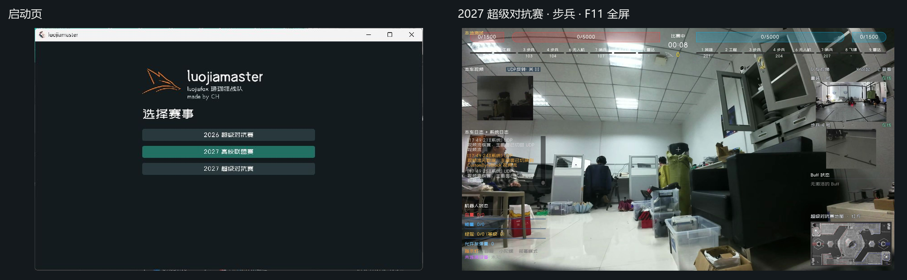
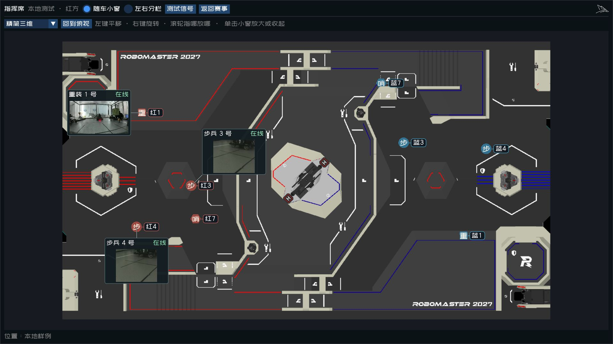

# luojiamaster 自定义客户端

**luojiafox 珞珈狐战队 · made by CH**

**先解压仓库，再双击 [程序/luojiamaster.exe](程序/luojiamaster.exe)。** 在一台 Windows 电脑上选「本地测试」就能试完整比赛界面。开场先按 **F11** 全屏。接已有车辆和 2026 官方端时选「2026 超级对抗赛 → 正式登录」。

新电脑需要的文件、可选场馆和参考车经验见 [部署教程](部署教程/README.md)。想看哪些功能已交付、哪些还要做，见 [2027 开发路线](部署教程/2027开发路线.md)。

## 打开客户端

| 首页选项 | 可以体验什么 | 验证到了哪里 |
| --- | --- | --- |
| 2026 超级对抗赛 | 原登录、地图、比赛菜单、官方视频与工业相机；操作手可按岗位看另外两位队友 | 参考车已跑通完整视频链路。新版操作、自动配对和多机互看还要用这个入口上车复测 |
| 2027 高校联盟赛 | 3V3 比赛画面、双方控制度和六根血条、两路本车视频、联盟赛地图、一位队友视角 | Windows 本地赛况和实录已验证，正式入口也用本机测试服务核过。2027 官方端联调待做 |
| 2027 超级对抗赛 | 重装、步兵使用 7V7 基础比赛界面，可看两位队友；指挥手有独立单屏岗位 | 操作手和指挥席均已在本地试过。指挥席当前只开放本地测试 |

操作手的正式与本地入口共用比赛界面。正式登录接收现场数据，没收到视频显示等待。本地测试跳过官方登录，用内置实车录包和样例赛况，可以在这台电脑上换队、开菜单、试断流。

### 在自己电脑上试一局

1. 选「2027 高校联盟赛 → 本地测试 → 红方 → 步兵 3 号 → 开始测试」，按 **F11**。主画面是官方视频，工业相机在副窗，右下是按阵营显示方向的联盟赛地图。
2. 看顶栏。两方控制度均从 600 开始，下面每方是重装 1、步兵 3、哨兵 7 的血条。第 6 秒红步兵降到 150/300，第 9 秒左右时钟暂停，第 19 秒蓝步兵归零、蓝方控制度降到 585。模拟赛况约 39 秒一轮。缺数据会显示「等待」，收到零会显示 0。
3. 按 **H** 交换本车主副画面，**I** 将官方视频转 180°，**Esc** 开关比赛菜单。三个赛事都默认按录像或图传的原方向显示。菜单里返回赛事选择，换蓝方重开，上一局的状态清空。

正式比赛的控制度按裁判消息更新。重装 1 号的满血从 100 变为 450，取决于模块安装进度；步兵 3 号按底盘为 300 或 350；哨兵 7 号为 400。中途登录、还不知道对方满血值时，血条只标收到的血量，每格代表 100 点。

### 超级对抗赛怎么看新地图

选「2027 超级对抗赛 → 本地测试 → 重装 1 或步兵 3、4」，按 **F11**。右下角显示 2027 场馆全图，操作手的己方基地始终在左侧。红方使用原图，蓝方将底图转 180°。指挥席的二维总览固定红左蓝右，三维模型缺失时也用这张图。操作手的小地图目前用来看地形，正式坐标仍待官方数据核对。

### 操作手看队友

三个赛事均按登录阵营和岗位自动配对。联盟赛重装 1 和步兵 3 互看；两个超级对抗赛中，1、3、4 号各看另外两席，2026 赛季的 1 号是英雄。正式互看使用专用队友有线网，各机具体地址和检查方法见 [工具与接线](工具/README.md#四台电脑的当前摆法)。

| 操作 | 联盟赛 | 两个超级对抗赛 |
| --- | --- | --- |
| K | 收起或展开右侧一格 | 收起或展开右侧上下两格 |
| L | 放大一位队友，再按回本车 | 打开两路左右并排，再按回本车 |
| 单击、滚轮 | 在队友画面上滚轮放大细节 | 在并排页单击某一路单独看，再点回两路。滚轮只放大鼠标指着的画面 |

### 不上车试一次 7V7 指挥席

1. 选「2027 超级对抗赛 → 本地测试 → 红方或蓝方 → 指挥手 → 开始测试」，按 **F11**。默认选中「随车小窗」，重装 1、步兵 3、步兵 4 的实车录像各自跟着己方同号棋子。录像分别来自官方图传、工业相机原片第 5～9 秒和第 10～14 秒。地图上的八辆车使用本地位置样例。
2. 鼠标移到小窗上，小窗停稳，录像继续。**单击放大，再点缩回；直接点另一路就换人。** 在视频上滚轮看细节，在地图上左键平移、右键旋转、滚轮指哪放哪。放大视频后仍能看见周围地图。
3. 顶部随时可以切到**「左右分栏」**，恢复左地图、右三路视频的原布局。两种布局使用同一局的录像和地图视角。上一版分栏交付留在 Git 提交 `a05a473`。
4. 试掉线时可选蓝方，打开「测试信号 → 暂停蓝 3 位置」。等满 10 秒，该车录像会移到地图底部，显示「位置待更新」。恢复位置后，小窗重新跟车。「断开 步兵 3 号」则只暂停这一路录像。平移到车在屏幕外时，小窗会标「在画面外」。

EXE 内置二维场馆和录像。三维需要同级 `arena/light.mesh` 或 `arena/detailed.mesh`；缺对应模型时自动显示二维。获取与放置方法见 [部署教程](部署教程/README.md#22-电脑需要什么)。[查看原分栏布局实图](档案/数据/2027指挥席-八车全屏.png)

## 当前版本和验证范围

| 2026-11-20 Windows 交付 | 当前记录 |
| --- | --- |
| 对照节点 | 11 月 18 日 `c03d519` 已有联盟赛单屏。此后新增操作手按岗位互看，以及 7V7 本地指挥席、三路实车录像、红蓝棋子和定点看场馆 |
| 程序 | `程序/luojiamaster.exe`，15,850,496 B，编译时间为北京时间 2026-11-20 18:32:21 |
| MD5 | `991e38b7aed1a71087b75e148246b235`，已与构建产物核对一致 |
| 随车小窗与左右分栏 | 12 项回归通过。1920×1080 的 F11 全屏、三路实车录像均为 1080p30，每档记录 60 秒。重装 1、步兵 3、步兵 4 分别显示的新画面数：左右分栏 1770、1799、1799 张，随车小窗 1776、1800、1800 张。整窗 95% 的刷新间隔分别在 18.44 和 18.16 毫秒内。三路中最长一次画面停顿分别为 92.7 和 86.7 毫秒。[查看逐路数据](档案/数据/2027指挥席-布局对比.json) |
| 前一版地图与品牌检查（`a05a473`） | 11 项自动测试全部通过。2027 超级对抗赛的红蓝六席均验证了整图比例和方向；另用红方步兵 3、蓝方步兵 4 测本地入口，蓝方重装从正式入口接入本机录像服务。1920×1080 副屏实按 F11，地图底边完整，切到其他应用时会让出前台。用 125% 字体与间距在两种大窗口尺寸做显卡离屏绘制，四组顶栏检查均未盖住原有内容。Windows 读到正确的产品、团队和署名，EXE 七层图标与上一版逐字节一致。 |
| 上一版地图导航专项 | 两种三维、二维和缺模型回退都用实际输出画面检查。鼠标左拖 41×23 像素，地标同样移动 41×23 像素；三个地标各缩放三格，最大偏移小于 1 像素。放大高台立即右拖，旋转中心最多偏 0.34 像素 |
| 现场范围 | 26 赛季全向轮步兵是参考车；11 月 4 日验证的是当时的队友互看，11 月 12 日验证的是工业相机到客户端的完整视频链路。当前三路指挥席使用录像，八车位置使用样例。新版多机、指挥席正式身份、实际位置数据及第二块显示器另行联调 |

上一版三路实录在 1920×1080 全屏各测 60 秒，开棋子后分别提交 1782、1798、1799 张新图，95% 的整窗刷新间隔在 18.458 毫秒内。更早的合成片、地图对照和稳定性长测按各自版本保存。[三路实测原始数据](档案/数据/2027指挥席-棋子与实车录像.json) · [各阶段数据与历史记录](档案/README.md)

11 月 16 日的基础版只完成了短测，长时内存仍需观察；此前一小时回放有三项验收未通过。原始数字保留在 [基础版检查](档案/数据/client-foundation-20261116.json) 和 [性能记录](档案/数据/client-performance-20261115.json)。

## 部署、维护和开发

| 你要做什么 | 去哪里 |
| --- | --- |
| 第一次从 GitHub 下载，或让另一台电脑用上客户端 | [部署教程](部署教程/README.md) |
| 接现有 2026 官方端或队友专线，查登录、无画面、掉线 | [工具和现场接线](工具/README.md) |
| 单独检查 Windows 解码和显示 | 双击 [离线测试](工具/离线测试.bat)，选内置双路样本，约 20 秒结束。要试指挥席则从 EXE 首页进入 |
| 修改客户端源码并编译、复现本地画面或性能检查 | [开发者编译与离线复核](工具/README.md#开发者编译与离线复核) |
| 查参考车经验、历史结论或下一阶段 | [参考车部署与已踩过的坑](部署教程/README.md) · [历史档案](档案/README.md) · [已实现和待实现的路线](部署教程/2027开发路线.md) |

**实车操作不要按 Ctrl。参考车固件会把它当作整车复位。**

## 产品与参考来源

赛事界面、队友视角和指挥席由珞珈狐战队在 ACE 客户端框架上开发。软件、源码与 Windows 文件属性采用同一套产品署名。界面里的线条狐来自战队官方队标，EXE 使用队内特殊版图标。

| 用在哪里 | 来源 |
| --- | --- |
| 基础客户端框架 | [ACE_RM26_CustomClient](https://github.com/ACE-Algorithm/ACE_RM26_CustomClient) · [原作者声明](源码/LICENSE) |
| 2027 超级对抗赛二维图 | 官方比赛规则手册 V1.0.0 图 4-1（[规则入口](https://bbs.robomaster.com/wiki/20204847/1969149)） |
| 指挥席精简三维场馆 | [hxyulin · rm-map-tools](https://github.com/hxyulin/rm-map-tools) |
| 指挥席精细三维场馆 | [掉分员 · RMUC_2027map_unity](https://github.com/diaofenyuan/RMUC_2027map_unity) |

场馆文件的来源和放置方式见[部署教程](部署教程/README.md#22-电脑需要什么)，比赛场地的原始设计来源见[场馆说明](程序/arena/NOTICE.md)。
