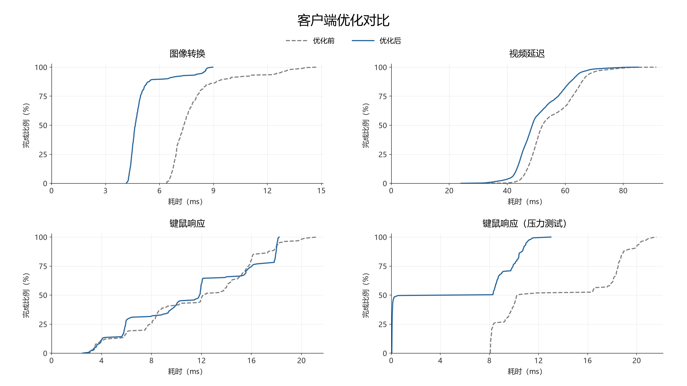

# luojiamaster 自定义客户端

**平时只需双击 [程序/luojiamaster.exe](程序/luojiamaster.exe)。** 本页统一说明当前版本、操作、编译和验证。**新电脑安装、其他车辆接入，以及Jetson/电控的改法和关键经验，看 [部署教程](部署教程/README.md)。** 详细网卡接线照 [工具 README](工具/README.md) 做。

本客户端是当前仓库的开发核心，面向接口匹配的不同车辆；26赛季全向轮步兵是已经实测的参考车，不是客户端限定的车型。

## 打开客户端

双击 EXE，先选赛事，再选「正式登录」或「本地试用」。两种方式进入同一个赛事界面，切视角、放大窗口和开菜单的操作相同。正式登录接收官方数据。本地试用使用电脑里的录包和模拟赛况，所有操作都留在本机。

| 首页选项 | 能用什么 |
| --- | --- |
| **2026 超级对抗赛** | 现有车辆、2026 裁判端和选手端的实车入口。用原登录、地图和菜单，可测官方图传与工业相机切换（H）、手动翻转（I）、全屏（F11），以及接好队内网线后的队友小窗（K）。 |
| **2027 高校联盟赛** | 3V3 直接进入完整比赛画面。步兵 3 号默认以官方图传铺底，重装 1 号默认看工业相机。另一视角放在副窗，2027 联盟赛地图在右下角。 |
| **2027 超级对抗赛** | 单独的 7V7 入口，目前使用基础地图、视频和原有菜单。专用岗位和双屏按[开发路线](部署教程/2027开发路线.md)推进。 |

### 在自己电脑上试一局

1. 双击 **程序/luojiamaster.exe → 2027 高校联盟赛 → 本地试用 → 红方 → 步兵 3 号 → 开始试用**。无需接车、改网卡或另外下载视频。
2. 第一眼看铺满窗口的本车图传和视频副窗。上排两根大条显示红蓝方控制度，中间显示比赛时钟。下排每方三根小血条，依次是重装 1 号、步兵 3 号和哨兵 7 号。四周显示本车和设备状态、增益、比赛提示、日志及队友小窗；队友未接入时小窗会说明原因。右下角是按红蓝方调整方向的 12×8 米场地图。
3. 按 **H** 交换两路本车画面，按 **I** 将官方画面旋转 180°。按 **Esc** 打开半透明比赛菜单，再按一次收起。右上角方框用于最大化。想让画面占满整块屏幕，按 **F11**，再按一次回到原来的窗口。
4. 在比赛菜单点「返回赛事选择」，重新进联盟赛本地试用，换蓝方步兵 3 号。新一局收到开场数据后双方控制度回到 600，视角和地图方向跟随所选阵营。

赛况按下表每 **39 秒**循环。视频用真实接收过的 **3.996 秒**录包反复播放，包含 2783 条官方图传记录和 158 条工业相机记录，分别从客户端自己的收包入口进入。两路停流只在每次登录后的第一圈各演示一次。比赛倒计时、暂停和血量每局重复。

| 从开始试用算起 | 画面上看什么 |
| --- | --- |
| 开局 | 红蓝各 600 点控制度。默认红步兵 300 血、蓝步兵 350 血、重装 100 血、哨兵 400 血。 |
| 第 6～9 秒 | 红步兵降到 150/300，两队小血条各自更新；红方控制一处区域后，蓝方控制度第一次从 600 降到 599。 |
| 第 9～14 秒 | 比赛暂停，时间停在 00:19，控制度维持 600 比 599。恢复后，蓝方每秒掉 1 点，到第 18 秒剩 595。 |
| 第 19 秒 | 蓝步兵战亡，血条归零。蓝方控制度一次扣 10，从 595 降到 585。 |
| 第 16～18 秒、第 20～26 秒 | 依次停发官方视频和工业相机，检查一路断开时另一路仍能显示。 |
| 第 33 秒、第 39 秒 | 本局时间到，示例裁判回传红方胜利。下一局开始时双方恢复 600。 |

**血条怎么看。** 有可信上限时显示「当前 / 满血」。步兵满血按底盘为 300 或 350；重装开局 100，完成规则指定的安装后为 450；哨兵为 400。中途登录时，若对方车辆的配置还不能确定，就只写实际血量，每格 100 点；收到零显示 0，尚未收到数据则显示「等待」。正式入口取裁判消息 `GlobalUnitStatus` 的第 15、16 字段作为双方控制度，按登录阵营换算到左红右蓝。每方初始 600 点；一方每控制一处区域，对方每秒扣 1 点，本方每战亡一台扣 10 点。胜负以裁判回传为准。

试用录包默认按原方向显示。试用画面标有「本地试用」。试用里的步兵在开赛前可选底盘，开赛后以模拟裁判锁定的档位为准。其它未模拟的操作只显示申请。2027 联盟赛当前开放比赛信息和画面操作，车辆键鼠接管留待实车联调。2027 官方端发布后，再核对真实登录、裁判数据和操作回执。两台电脑之间的队友视频需单独接线测试。

## 连接官方端

1. **先开官方端。** 官方选手端应已登录并正常显示图传；按官方端的 `P`，把“键鼠控制来源”设为“自定义客户端”。
2. **确认网线地址。** 本机接官方端的网口为 `192.168.12.2`、掩码 `255.255.255.0`，网关和 DNS 留空；对应官方端为 `192.168.12.1`。
3. **选自己的赛事 → 正式登录。** 现有 2026 官方端选「2026 超级对抗赛」，服务端填 `192.168.12.1:3333`，选择和官方端相同的队伍、机器人，再登录。未收到图传时显示等待。

**不要按 Ctrl，固件会把它当作整车复位。** 本客户端没有 `P` 设置面板；鼠标灵敏度在登录页，默认0.4，可按手感调整。新电脑若报缺少 `MSVCP140.dll` 或 `VCRUNTIME140_1.dll`，安装 Microsoft VC++ 2015–2022 x64 运行库后再打开，无需安装编译器或 FFmpeg。

## 常用按键和队友画面

| 操作 | 作用 |
| --- | --- |
| `F11` | 三个赛事都可进入或退出全屏。从最大化进去，退出时仍是最大化。 |
| `Esc` | 3V3 在视频上打开或关掉比赛菜单。2026 原界面沿用进入或退出比赛模式的操作。 |
| `H` | 本车官方画面与工业相机第二视角切换 |
| `I` | 三个赛事的官方图传默认按原方向显示。按一次转 180°，再按一次还原。队友端会收到发送方选的方向 |
| `K` | 队友小窗折叠或展开 |
| `L` | 队友画面占主画面，再按一次恢复 |
| 滚轮 | `L` 模式下将队友画面放大1–4倍 |

按键对当前有焦点的比赛窗口生效。联盟赛中，右上角队友视角一开始只占一行，收到队友画面会自动展开。按 `K` 可以自己收起或展开，收起后继续收视频。未连接时展开可看原因；本地试用只带本车两路录像。

两台客户端之间用另一块网卡直连，A机为 `10.77.0.1`，B机为 `10.77.0.2`。程序默认按A机找B机；另一台点击队友小窗标题上的 `[默认A]` 切为 `[B]`，选择保存到 EXE 旁的 `队友视角.ini`。**目前仍是手工选 A/B，不是自动识别或自动登录。**

队友链路转发对方已经收到的官方 HEVC 原始字节，不再次编码。当前只连接一个队友，不转发本车工业相机第二视角。它走两台 Windows 间的 TCP47700，与车端300 B/50包的通道分别运行。完整网卡、角色、防火墙和判读步骤见工具 README。

## 当前版本和验证范围

| 项目 | 当前记录 |
| --- | --- |
| 唯一交付程序 | `程序/luojiamaster.exe`，与 `源码/build/release/luojiamaster.exe` 字节一致 |
| 版本 | 三赛事图传默认原向、F11 全屏和联盟赛队友小窗修复 |
| 文件大小、时间 | 15,072,768 B，2026-11-18 20:36:40（北京时间） |
| MD5 | `a535ed2723e72c799ba6f935310c91b8`；两台客户端应一致 |
| 车端 | 继续使用 [Jetson B 档](../autoaim/README.md) 与 [云台 DMA](../lower-machine/README.md)，本次客户端整理不要求重复部署或烧录 |

已完成的实车记录是：11-04四台电脑互看复现成功；11-12云台DMA修复后，CH确认工业相机经官方全链路出画正常。新版客户端的登录、窗口放大、升级菜单和正常操控仍需实车复测。

**本次 Windows 验证**

三个赛事的正式和试用共六个入口均验证默认翻转关闭，三个比赛窗口都已实测 F11 全屏与还原。联盟赛在本机用两段不同录像分别模拟本车和队友，实际检查了 K 收起、再次展开后继续出画，以及未连接和本地试用时的提示。7 项自动检查通过。

**联盟赛大屏与比分验证**

在本机 2560×1600 的 Windows 屏幕上实测了普通窗口、最大化和 F11 全屏。播放中打开、关闭 Esc 菜单，再退出全屏，窗口恢复到进入前的大小。大屏上增大读数和地图地名，同时把两侧区域各收至约 18% 宽。顶栏按窗口重新排布，视频和地图保持原比例。

用同一帧录像和同一组裁判消息分别打开改前、改后 EXE，最大化截图对比。右侧柜面的平均亮度（0～255）为原片 112.9、旧版 53.9、新版 112.7；中央 461×320 个像素逐点对比，亮度一样。正式入口连接本机测试服务显示红 587 比蓝 543，有暂停时钟、真实零血量和上限未知的车辆。

本地试用实测了红步兵 300 满血、蓝方控制度降到 585、蓝步兵战亡，以及换蓝方后 350 满血、双方控制度重置为 600、地图转向。首圈模拟断流期间曾看到两路短暂同时等待，随后恢复。7 项自动检查全部通过，协议样例另核对了缺字段、真实零、不同阵营及换局清空。2027 官方端及两块不同缩放比例的实体显示器仍待联调。 [查看同一帧录像的改前、改后实图](档案/数据/2027联盟赛-比赛画面改前改后.png)。

<details>
<summary>11 月 18 日早期版本的验证记录</summary>

上一版完整 HUD 使用本机双路录像，验证过 H/I、Esc、换队、断流以及菜单回执。28 秒回环收到官方视频包 17,892 个、工业相机包 863 个，逐包对齐。旧试用把步兵满血写为 250，本版已按规则更正。


上一版三项赛事入口包含独立的 3V3 岗位布局，大小 15,033,344 B，MD5 为 `766a36acf26e5c5485ad855585a5721d`，编译时间为北京时间 17:16:49。7 项自动检查通过。Windows 窗口测过红蓝步兵、双路视频、最大化、切主视角、暂停及恢复、ESC 菜单和蓝方开局。7V7 本地试用一次共提交官方画面 444 张、工业相机画面 302 张，返回 2026 正式登录页后两路累计均为 0，屏幕显示「等待图传」。

旧双赛事入口版大小 15,009,792 B，MD5 为 `85b5eea1860721c8c224b8e513120a02`，编译时间为北京时间 14:59:15。各阶段的 6 项 C++ 回归通过。

- 单窗口检查确认 7V7 的官方视频 1920×1080、工业相机 320×256 均能出画，基础地图可见。队友小窗当时显示本机测试卡。
- 3V3 原岗位页在无源时显示等待。仅送本机官方视频包时官方格出画，停发后提示中断。另用本机 MQTT 样例服务登录红方 1 号，仅送工业相机包，记录到工业相机提交新图 109 张，官方路 0 张。
- 当时的独立体验页测过步兵、重装、主副画面切换、红蓝翻转、最大化和返回重选。重装首圈回放实际提交官方 169 张、工业相机 68 张，仍有输入跳帧。地图源为 `源码/resources/rmul-2027-3v3.svg`，显示按 12×8 米内沿绘制。

旧版独立检修入口仍可通过 `luojiamaster.exe --ul-preview` 打开。平时试用完整客户端走首页的「本地试用」。

</details>

## 11月16日整理与补测

程序目录只保留正式EXE和本机运行设置；维护、离线测试各一个入口。使用、编译和排错合并到本页，现场接线在工具README，历史曲线和精选数据归档。旧日志已移到维护电脑保存，不随工程交付。

修复离线测试的两处问题：模拟输入丢失后明确记账并继续，结束时补写包含收尾阶段的最终GPU等待计数。实际操控、视频解码和显卡显示代码未改动。正式编译入口增加目录核对、真实测试执行检查和校验后同步；网络自检拒绝把本机当作队友。

本次6项C++回归、49项Python检查通过；约4分56秒双路回放未闪退，1177次模拟输入全部匹配，丢失0，最终GPU等待超时0。另完成60秒窗口放大、恢复和菜单专项，以及13秒等待故障注入后的恢复；整理后的离线入口20秒双路出画正常。

按CH要求提前结束原计划长测，记录仍标为未完成，不写成新一小时验收通过。短测内存首末分段均值增加约11.8 MiB，后半段斜率5.90 MiB/分钟，超过原长测4.0门限，保留观察项；还没有据此确定原因。旧一小时的3项失败原样保留。实际记录见[基础版精选数据](档案/数据/client-foundation-20261116.json)。

<details>
<summary>11月15日本机优化数据和仍需补齐的验收</summary>

官方主画面使用三槽对齐缓冲，颜色转换直接写进可复用内存，少做一次整图复制；键鼠检查移到视频上传之前。原消息字段、鼠标累计方式和13 ms最短发送间隔保留。

| 本机测量 | 优化前 | 优化后 | 耗时减少 |
| --- | ---: | ---: | ---: |
| 1080p图像转换，中位数 | 7.35 ms | 4.66 ms | 36.6% |
| 客户端内视频延迟，P95 | 68.99 ms | 65.02 ms | 5.8% |
| 普通负载本地输入响应，P95 | 18.22 ms | 18.06 ms | 0.9% |
| 人工压力本地输入响应，P95 | 20.26 ms | 11.01 ms | 45.7% |



采用同一台Windows、同一录流、同一个带记录程序的旧新路径，未把历史EXE重新测过当作事实。图像转换每档264个预热后样本；视频每档3×120秒；输入每档3×45秒。后两类曲线为三轮对应分位耗时的中位数。P95表示95%位置的耗时。

视频从本机收齐该帧所需码流到成功提交显示计时；输入从模拟事件进入到本地消息接收计时。人工压力档每个界面帧增加8 ms实际计算。它们没有测机器人动作延迟。短时对照中主、副画面实际新图更新约60/20 fps，颜色和分辨率不变。

本轮记录有5项CTest、6项显卡故障恢复检查，以及118张真实1080p转换、1308张第二视角输出的像素一致性回归。双路视频离线回放60分钟未闪退，预热后首尾内存均值增加约1.34 MiB。

**一小时完整验收尚未通过，原记录保留3项失败。** 模拟按键探针在约517.764秒后停在一个待匹配事件，导致两项输入记账不一致；汇总文件缺最终GPU等待次数，第三项按未知保留失败。逐秒等待计数为0不能代替缺失的最终值。已完成的短时性能对照仍独立保留。

数据、版本与校验值见 [11-15精选记录](档案/数据/client-performance-20261115.json)。此前闪退的4份真实转储、空对象缺陷、30分钟离线测试和20项恢复检查见 [11-12稳定性记录](档案/2026-11-12-客户端视频稳定性修复.md)。旧记录属于对应版本，不覆盖为新结果。

</details>

## 日常工具与排错

- 第一次接线、换网卡、设置角色、放行端口：打开 [工具/README.md](工具/README.md)，运行 `工具/维护工具.bat`，按用途选择。
- 维护人员只检查视频解码和显示时，运行 `工具/离线测试.bat`，约 20 秒可得到双路出画结果。
- 有异常先保留时间和 `程序/logs/` 对应会话，记下是哪路画面、是否切换窗口或打开菜单。不要为测试按Ctrl。

| 现象 | 先查什么 |
| --- | --- |
| 连接反复重试 | 官方端是否登录、3333是否监听、`192.168.12.1`是否可达、机器人ID是否一致 |
| 登录后主画面黑 | 官方端自己有没有画面；客户端入站UDP3334是否放行 |
| 有画面但不能操控 | 官方端P面板来源、客户端Esc模式、比赛阶段与执行器状态 |
| 队友未连接 | 另一块网卡的10.77地址、A/B角色、TCP47700和对方程序 |
| 第二视角等待 | 查看Jetson编码发送、C板完整输出、官方端收包及客户端解码，逐跳找第一处异常 |

日志每秒一行“视频探针”：`udp_in/custom_in` 是成功提交显示的新图数；`cbb pkt_in` 是收到包数，`frames_out` 是解码出图数。`udp_ago/custom_ago` 是距最近新图提交的时间，`-1` 表示还没显示首帧。这些计数不能互相替代。

队友标题绿色表示最近1秒有新图，1–5秒变为非实时状态，超过5秒换等待提示；连上TCP不等于正在更新画面。队友日志的发送、接收、解码、丢帧和队列应一起看。

<details>
<summary>开发者编译与离线复核</summary>

准备 Visual Studio 2022 的C++桌面开发、Windows SDK、CMake和Ninja。项目提供FFmpeg静态库和多数依赖。Boost体积超过仓库限制，首次编译任选一种准备方式：

- 从队内已编译的电脑复制整个 `源码/3rdparty_downloads/boost/`，连同里面的 `.unpacked` 标记。
- 手动下载本工程指定的 [boost-1.91.0-1-cmake.tar.xz](https://github.com/boostorg/boost/releases/download/boost-1.91.0-1/boost-1.91.0-1-cmake.tar.xz)，放进 `源码/3rdparty_downloads/_archives/`，再运行该目录上一层的 `解压依赖.bat`。压缩包SHA256应为 `cc5dc5006ecbdf0051f90979be31b4eee5987d9ae14ae9fb9c03cfa43fa3cdad`，与CMakeLists一致；压缩包和Boost解压目录都不提交Git。

正式编译入口只使用已经准备好的依赖，不在编译中自动下载。

两处已有实测坑：配置用 `-DFETCHCONTENT_FULLY_DISCONNECTED=ON`；构建必须在VS开发环境里，否则可能链接不到Windows SDK的 `oleaut32.lib`。正式一键脚本会进入开发环境。中文路径通过短路径junction编译，链接必须指向本仓库源码，不能指到旧工作区。

第一次在新电脑编译时，在仓库根目录的管理员PowerShell建立短路径；现有链接会交给编译脚本严格核对，指错时停止：

```powershell
$rm26Source = (Resolve-Path -LiteralPath '.\luojiamaster\源码').Path
if (-not (Test-Path -LiteralPath 'C:\rm26build')) {
    New-Item -ItemType Junction -Path 'C:\rm26build' -Target $rm26Source | Out-Null
}
```

之后在仓库根目录的PowerShell运行。`-Verify`构建并执行已注册测试，`-SyncDelivery`在测试通过且客户端已退出后同步交付EXE：

```powershell
& '.\luojiamaster\源码\一键配置与编译.bat' -Verify -SyncDelivery
if ($LASTEXITCODE -ne 0) { throw '编译、测试或同步未通过，请保留原始输出。' }
```

**用同一段录像和赛况核对正式入口。** 上面的编译完成后，装有 Python 3 的 Windows 可在本机运行。两个 PowerShell 窗口都先进入仓库根目录。第一个窗口运行下面一行，看到 `READY` 后保留窗口。登录成功后播放 45 秒，结束时服务自行退出。

```powershell
python '.\luojiamaster\源码\tests\loopback_match_replay.py' --seconds 45
```

第二个窗口运行下面几行。它们将本版客户端放入新建的临时文件夹，并为这个副本关闭队友连接。选红方步兵 3 号，在登录框确认服务端是 `127.0.0.1:59335`，点「登录」。正式入口从本机网络收到与「本地试用」相同的两路录包和赛况。关掉客户端即可结束查看。

```powershell
$rmHudCheck = New-Item -ItemType Directory -Path (Join-Path $env:TEMP ("rmul-hud-" + [guid]::NewGuid()))
Copy-Item -LiteralPath '.\luojiamaster\程序\luojiamaster.exe' -Destination $rmHudCheck.FullName
Set-Content -LiteralPath (Join-Path $rmHudCheck.FullName '队友视角.ini') -Value 'peer=off' -Encoding Ascii
& (Join-Path $rmHudCheck.FullName 'luojiamaster.exe') --competition=ul2027 --mqtt_server 'tcp://127.0.0.1:59335' --video_port 59336
```

现成码流放在 `源码/tests/fixtures/测试画面.h265`。图像转换复核只测转换环节，输出到临时目录：

```powershell
& '.\luojiamaster\源码\一键配置与编译.bat' -CI -Targets real_conversion_benchmark
& '.\luojiamaster\源码\build\release\real_conversion_benchmark.exe' '.\luojiamaster\源码\tests\fixtures\测试画面.h265' "$env:TEMP\rm26-rgba.csv"
```

双路离线测试需要维护人员保存的真实 `network_capture.bin`，完整录流不入库；内置小样本可直接用工具离线测试。在源码目录运行，并替换自己的路径：

```powershell
.\build\release\luojiamaster.exe --offline-video-test --capture="D:\录包\network_capture.bin" --seconds=120 --replay-window-seconds=35 --performance --no-window-exercise --report-dir="D:\临时测试\新版"
```

`--performance-baseline` 选择旧转换路径和晚采样；在该档再加 `--early-input`，只比较采样位置。`--ui-work-ms=8` 是人工压力档。记录入口在任何正常网络服务创建前进入，不连接车辆。性能分析用 `源码/tests/analyze_video_performance.py`，长测用 `audit_long_video_performance.py`；历史缺项按原失败保留。

源码变更后检查重复块，避免同一个 `std::thread` 重复赋值造成退出。中文路径文件和进程操作沿用 `platform_util`，不重新引入裸 `fopen/ofstream/system`。`.md`用UTF-8无BOM+LF，脚本按仓库编码约定维护。

</details>

<details>
<summary>维护者需要知道的通信与显示边界</summary>

| 路径 | 当前实现 |
| --- | --- |
| 官方主画面 | 官方端UDP3334，HEVC；8 B大端分片头为 `u16 frame_id / u16 shard_id / u32 frame_bytes`，拼齐后解码 |
| 第二视角 | 官方端MQTT `CustomByteBlock`，H.264；当前300 B内含2 B大端长度、2 B大端序号和最多296 B码流，余下补0 |
| 队友主画面 | 两台Windows之间TCP47700，原HEVC字节；8 B握手 `RMTM/version/flags/reserved`，每帧4 B长度、4 B flags和负载 |
| 比赛数据 | MQTT3333，25个既有订阅请求QoS0；客户端发布使用QoS1。keep_alive 5秒、clean_session=true；通过官方选手端，不直连赛事引擎 |
| 键鼠上行 | `KeyboardMouseControl`；低16位按键、鼠标增量与按键，13 ms最短发送门限，实际频率取决于界面运行 |
| 自定义上行 | `CustomControl`每100 ms；当前代码为5×u16敌方血量加3字节状态/计数，共13 B；旧文写10 B有误 |
| 地图标记 | `MapClickCmd`经官方MQTT发出，与客户端之间的队友视频不是同一路 |

官方视频优先尝试 `hevc_cuvid`，失败回退HEVC软解，实际所用解码器看日志；不凭注释认定一定软解或一定硬解。CBB和队友解码分别运行，三路最后共用UI线程和GPU，不能称“三路互不干扰”。输出各保留最新1帧，CBB输入最多128包，溢出重置并等关键帧；队友发送8帧、解码输入16帧，满时丢旧。TCP未丢字节也不能保证被丢弃的参考帧不会影响后续解码。

本机MQTT发布的QoS1只涉及客户端到官方端这段消息交付，不能据此认定官方无线段已重传或机器人已经执行。

第二视角序号不连续时等关键帧；输入零填充、EAGAIN重送和资源安全恢复按现有代码处理。显示超时只决定保持、回退与提示，不会提高链路帧率。主画面、副画面和队友画面的帧数、包数、更新时间分别统计。

默认A/B、端口占用后的自动上探和ini优先级见工具README。正式通道沿用 2026 已验接口，2027 现场字段和显示权限等官方端到位后再联调。

</details>

## 目录与历史

| 位置 | 用途 |
| --- | --- |
| `程序/` | 唯一交付EXE；运行后生成配置和日志 |
| `工具/` | 维护、离线测试入口和详细网卡接线 |
| [部署教程](部署教程/README.md) | 新电脑安装、跨车型接入、Jetson和电控移植要求，以及已踩坑的必保留改法 |
| `源码/` | 工程、必要回归、`tests/fixtures/`小素材 |
| `档案/` | 独有历史实测、更正、精选数据和响应曲线；[索引](档案/README.md)说明旧路径去向 |

改车端文件仍走ToDesk；Jetson只编 `standard_mpc video_sender_test`；电控烧录须CH确认。历史文档中的旧EXE、灰度8包、阻塞串口、疑似无线瓶颈和旧“下一步”只属于当时版本，不再作为当前操作步骤。

本项目基于 [ACE_RM26_CustomClient](https://github.com/ACE-Algorithm/ACE_RM26_CustomClient) 二次开发，沿用原项目许可。
